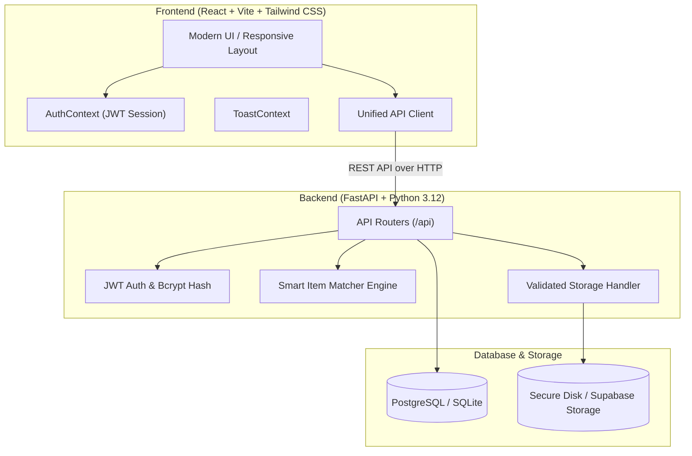

# 🎓 Smart Campus Lost & Found System
> **"Lost something? Let's find it."**  
> *A full-stack, production-grade university portal for reporting, discovering, and securely recovering lost campus belongings with smart similarity matching.*

---

## 📌 Table of Contents
1. [Overview](#-overview)
2. [Architecture Overview](#-architecture-overview)
3. [Key Features](#-key-features)
4. [Smart Matching Engine](#-smart-matching-engine)
5. [Tech Stack](#-tech-stack)
6. [Database Schema](#-database-schema)
7. [Getting Started Locally](#-getting-started-locally)
8. [Demo Credentials](#-demo-credentials)
9. [Running Automated Tests](#-running-automated-tests)
10. [Deployment Guide](#-deployment-guide)
11. [Security & Privacy Design](#-security--privacy-design)

---

## 🌟 Overview

**Smart Campus Lost & Found** is a modern full-stack web application built for college and university campuses. Instead of relying on disorganized WhatsApp groups, scattered bulletin boards, or unmoderated social media pages, this system provides:
- **Centralized Listings**: Instant reporting for both lost and found items.
- **Smart Matching Engine**: Background TF-IDF text similarity, location proximity, and category matching that automatically pairs lost items with found items (scored 0–100%).
- **Privacy-Preserving Contact & Claims**: Claimants submit private proof of ownership without exposing personal phone numbers or email addresses publicly.
- **Campus Moderation & Audit**: Administrative controls to review suspicious listings, handle disputes, and maintain campus safety.

---

## 🏛 Architecture Overview



---

## 🚀 Key Features

### 1. Public Exploration & Search
- **Instant Search**: Filters by keyword across item title, detailed description, category, and campus building.
- **Category Explorer**: 8 dedicated campus categories with curated Lucide icons (*Electronics*, *ID Cards*, *Wallets*, *Bags*, *Books*, *Keys*, *Accessories*, *Other*).
- **Multi-Filter Engine**: Combine Lost/Found toggles, campuses, categories, and date sort orders seamlessly with URL query parameter synchronization.

### 2. Validated Reporting
- **Lost Item Form**: Date picker, campus selector, specific hall/building, item description, and preferred contact channel.
- **Found Item Form with Privacy Shield**: Guidance prohibiting disclosure of secret identification numbers or passwords.
- **Drag & Drop Photo Uploads**: Client-side image preview, MIME-type verification, and 5MB size limit checks.

### 3. Smart Matching Engine
- **Transparent Weighted Algorithm**: Calculates similarity between opposite reports without requiring paid external AI APIs.
- **Keyword & Location Cosine Similarity**: Normalizes text and strips common stop words.
- **Proximity Weighting**: Compares event dates and campus locations.
- **Instant Notifications**: Alerts reporters automatically when a potential match exceeds 60% similarity.

### 4. Safe Claims & Handover Protocol
- **Private Proof Submission**: Claimants provide unique identifying features (e.g., lock screen wallpapers, inside contents, serial digits).
- **Finder Review**: Finder can accept or reject claims with private coordination notes.
- **Campus Handover**: Recommends completing physical handovers at the Central Campus Safety Desk.

### 5. Authenticated User Dashboard
- **My Lost Reports & My Found Reports**: Edit permitted fields, withdraw listings, or mark as returned.
- **Claims Center**: Track submitted claims and responses from finders.
- **In-App Messaging**: Private message history between student reporters.
- **Notifications Hub**: Read/unread states with one-click "Mark All Read".
- **Profile & Campus Settings**: Customize display name, campus facility affiliation, and change passwords.

### 6. Campus Admin Portal
- **Dashboard Metrics**: Real-time statistics for total reports, lost/found ratios, pending moderation items, active claims, and returned items.
- **Moderation Queue**: Review, approve, or reject user listings with administrative notes.
- **Content Flag Review**: Inspect user-submitted violation flags (spam, fake listings, privacy exposure).
- **System Audit Timeline**: Persistent record of all administrative actions.

---

## 🧠 Smart Matching Engine

The smart matcher (`backend/app/smart_matcher.py`) evaluates candidate reports using a weighted formula:

| Factor | Weight | Method |
|---|---|---|
| **Category Similarity** | 30% | Exact match check |
| **Description & Title** | 35% | Term-frequency TF-IDF cosine similarity & token normalization |
| **Location Similarity** | 15% | Building and landmark token overlap |
| **Campus Proximity** | 10% | Matching campus facility code |
| **Date Proximity** | 10% | Scaled based on absolute days difference (1.0 within 24h) |

*If categories completely mismatch and description overlap is low, score is capped at 25% to prevent false positives.*

---

## 🛠 Tech Stack

### Frontend
- **Framework**: React 19 + TypeScript
- **Bundler**: Vite 8
- **Styling**: Tailwind CSS v4 + Vanilla CSS tokens
- **Routing**: React Router DOM v7
- **Icons**: Lucide React
- **Testing**: Vitest + React Testing Library + JSDOM

### Backend
- **Framework**: FastAPI (Python 3.12)
- **Validation**: Pydantic v2 + Pydantic-Settings
- **ORM**: SQLAlchemy 2.0
- **Security**: PyJWT (HS256) + Bcrypt password hashing
- **Testing**: Pytest + Pytest-Asyncio + HTTPX

### Database & Storage
- **Primary / Local Fallback**: SQLite (`lostfound.db`) with foreign key pragma enabled.
- **Production Option**: Supabase PostgreSQL + Supabase Storage.

---

## 🗄 Database Schema

The database design is normalized and indexed for fast filtering:

- **`campuses`**: `id`, `name`, `location`, `code`, `created_at`
- **`users`**: `id`, `email`, `hashed_password`, `display_name`, `college_id`, `campus_id`, `role`, `contact_preferences`, `is_active`, `created_at`
- **`items`**: `id`, `public_id`, `owner_id`, `campus_id`, `title`, `description`, `category`, `report_type`, `general_location`, `event_date`, `image_path`, `preferred_contact`, `status`, `moderation_status`, `created_at`
- **`claims`**: `id`, `item_id`, `claimant_id`, `private_claim_details`, `proof_answers`, `status`, `finder_notes`, `created_at`
- **`contact_requests`**: `id`, `item_id`, `requester_id`, `recipient_id`, `message`, `status`, `created_at`
- **`favorites`**: `id`, `user_id`, `item_id`, `created_at`
- **`notifications`**: `id`, `user_id`, `type`, `title`, `message`, `related_resource_id`, `link_url`, `is_read`, `created_at`
- **`flags`**: `id`, `reporter_id`, `item_id`, `reason`, `details`, `status`, `created_at`
- **`audit_logs`**: `id`, `actor_id`, `action`, `resource_type`, `resource_id`, `details`, `created_at`

---

## 💻 Getting Started Locally

### 1. Clone & Setup Backend
```bash
cd backend

# Create virtual environment (if not already present)
python -m venv venv

# Activate virtual environment
# Windows PowerShell:
.\venv\Scripts\Activate.ps1
# Linux/macOS:
source venv/bin/activate

# Install dependencies
pip install -r requirements.txt

# Seed sample campus data (campuses, users, items, notifications)
python seed.py

# Start backend server
python -m uvicorn app.main:app --host 127.0.0.1 --port 8000 --reload
```
API docs will be available at: `http://127.0.0.1:8000/docs`

---

### 2. Setup Frontend
```bash
cd frontend

# Install dependencies
npm install

# Start Vite development server
npm run dev
```
Open `http://localhost:5173` in your browser.

---

## 🔑 Demo Credentials

Convenient quick-fill buttons are provided on the login page, or you can enter:

| Role | Email | Password | Permissions |
|---|---|---|---|
| **Campus Student** | `alex.chen@campus.edu` | `Student@123` | Report items, submit claims, in-app messaging, dashboard |
| **Campus Admin** | `admin@campus.edu` | `Admin@123456` | Listing moderation, review content flags, view audit logs |

---

## 🧪 Running Automated Tests

### Backend Tests (Pytest)
```bash
cd backend
.\venv\Scripts\pytest -v
```
**Results**:
- `test_smart_matcher.py`: 8 tests passing (exact category, different descriptions, empty descriptions, duplicate reports, different campuses, date proximity).
- `test_api.py`: 5 tests passing (health check, user registration & login flow, item creation & filters, claim submission & privacy, admin access control).

### Frontend Tests (Vitest)
```bash
cd frontend
npm test
```
**Results**:
- `src/test/app.test.tsx`: 4 component and page tests passing with JSDOM.

### Production Bundle Check
```bash
cd frontend
npm run build
```
Generates optimized production bundle in `dist/`.

---

## 🚢 Deployment Guide

### Frontend Deployment (Vercel / Netlify)
1. Push the `frontend` folder to GitHub.
2. Connect repository to Vercel or Netlify.
3. Set build command: `npm run build`.
4. Set output directory: `dist`.
5. Set environment variable: `VITE_API_BASE_URL=https://your-backend.onrender.com`.

### Backend Deployment (Render / Railway)
1. Push the `backend` folder to GitHub.
2. Create a new Web Service on Render / Railway with Python 3.12 environment.
3. Build command: `pip install -r requirements.txt`.
4. Start command: `uvicorn app.main:app --host 0.0.0.0 --port 8000`.
5. Environment variables:
   - `DATABASE_URL`: Your Supabase connection string.
   - `SECRET_KEY`: A secure random 64-character secret.
   - `BACKEND_CORS_ORIGINS`: `["https://your-frontend.vercel.app"]`.

---

## 🔒 Security & Privacy Design

- **Zero Plaintext Passwords**: Cryptographically salted hashes using standard `bcrypt`.
- **JWT Authorization**: Cryptographically signed tokens with expiration verification.
- **Privacy Enforcement**: Endpoints explicitly redact private claim details from unauthorized third parties.
- **Role Verification**: Admin routes check `current_user.role == "admin"` server-side.
- **Safe File Storage**: Enforces strict MIME types (`image/jpeg`, `image/png`, `image/webp`), 5MB size limits, and randomized UUID filenames to prevent path traversal.
- **Parameterized SQL**: Fully shielded against SQL injection through SQLAlchemy ORM parameter binding.
